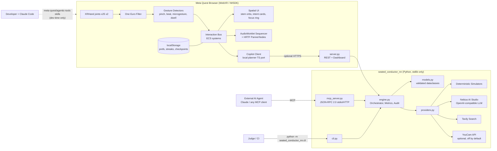
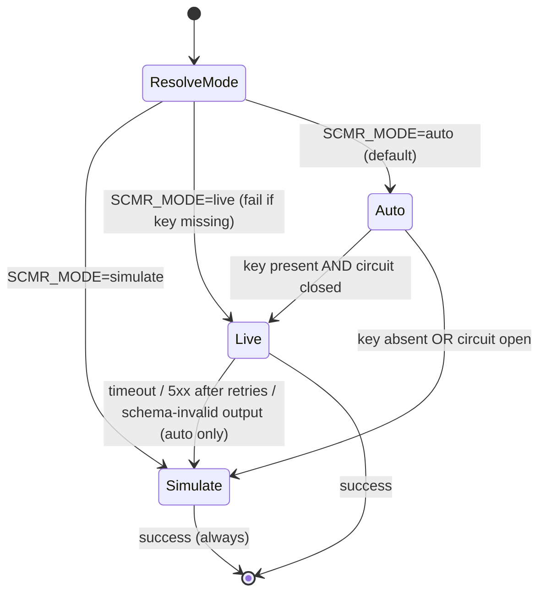
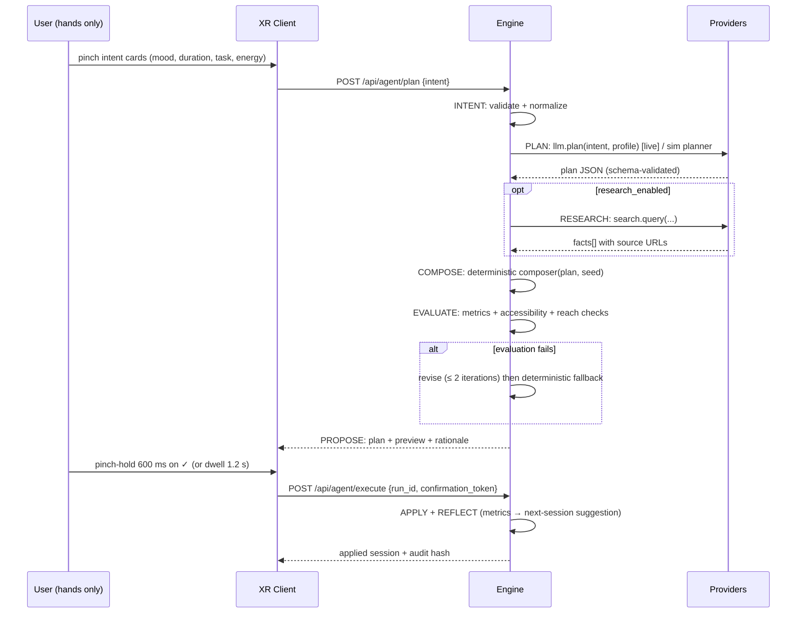

# DESIGN_OPUS55.md

## SeatedConductor MR: Hands-First Spatial Music & Productivity Studio for Meta Quest

| Field | Value |
|---|---|
| Document | Architecture & Implementation Design Specification |
| Version | 1.0.0 (2026-10-27) |
| Python package | `seated_conductor_mr` |
| XR client | Meta Quest IWSDK (WebXR), bootstrapped from `iwsdk-v0-template` |
| Competition | Meta VR Start Developer Competition 2026 |
| Submission deadline | **2026-11-18 12:00 PST = 2026-11-19 05:00 JST** (hard freeze) |
| Track | Productivity (primary), with a strong Entertainment surface (music visualization and spatial audio) |
| Division | New Experience (all code conceived and written on or after 2026-09-24) |
| Special awards targeted | Best Agentic Interaction, Best Accessibility Forward Experience (secondary: Best First Five Minutes, Best Reason to Come Back) |
| Author | Kazutoshi Hayashi (`cal29292929`) |
| License | MIT |

> **Track note:** Devpost asks each submission to pick exactly one track. This spec recommends **Productivity**, because the core loop is a "creative focus session" tied to a recurring daily moment. Entertainment features (spatial music visualization) support that loop. Switching to Entertainment needs no architectural change. Only the submission copy and the video's lead segment would change.

---

## Table of Contents

1. [Executive Summary & Judging Criteria Alignment](#1-executive-summary--judging-criteria-alignment)
2. [System Architecture & Multi-Model / API Data Flow](#2-system-architecture--multi-model--api-data-flow)
3. [Module-by-Module Specification](#3-module-by-module-specification)
4. [Security, Privacy & Reliability Constraints](#4-security-privacy--reliability-constraints)
5. [XR Client (IWSDK) Interaction Design](#5-xr-client-iwsdk-interaction-design)
6. [Performance Budgets (72/90 fps)](#6-performance-budgets-7290-fps)
7. [Testing & CI Strategy](#7-testing--ci-strategy)
8. [Delivery Plan to Deadline](#8-delivery-plan-to-deadline)
9. [Submission Checklist](#9-submission-checklist)
10. [Appendices](#10-appendices)

---

## 1. Executive Summary & Judging Criteria Alignment

### 1.1 One-paragraph pitch

**SeatedConductor MR** turns the space in front of a seated user into a conducting podium. The user conducts with bare hands: beat patterns set tempo, hand height sets dynamics, and pinching an instrument "stem orb" in a 100° arc solos or mutes it. The music is generated live by an original, procedural, rights-free sequencer. Each music session is bound to a productivity block: a 5 to 25 minute focus sprint, a morning warm-up, a commute wind-down. An in-headset agent, the **Conductor Copilot**, plans the session in multiple steps from a few pinch-selected intent cards, with no keyboard and no controller. It composes the score, checks that the score fits the user's accessibility profile and ergonomic reach envelope, proposes the result, and applies it only after a deliberate pinch-hold confirmation. The same capabilities are exposed to external AI agents through an MCP (JSON-RPC 2.0) server. Every agent action is recorded in a tamper-evident audit trail.

### 1.2 The three Devpost design tests

| Test | How SeatedConductor MR passes it |
|---|---|
| **Airplane seat test** (works within a 2 ft / 0.61 m radius) | Every interactable sits inside a calibrated **reach envelope**: radius ≤ 0.55 m from a head-anchored seated origin, azimuth ±50°, elevation −30° to +15°. CI enforces this with the `reach_compliance` metric, which must equal 1.0. |
| **One bus stop test** (a complete moment in ≤ 10 minutes; fast cold start and resume) | The default "Quick Movement" is a 3-minute focus-and-conduct loop. Cold start goes from page load to first sound in under 4 s (procedural audio, no large sample downloads). Pause and resume use the WebXR `visibilitychange` and `XRSession` `end` events, and session state is checkpointed to `localStorage`. |
| **Take it away test** (works without third-party services) | With all API keys removed, the full experience runs in **deterministic simulation mode**. That includes the composer, gesture engine, agent planner, metrics, and audit trail. Third-party APIs only *enrich* the experience (LLM phrasing, reference research, optional cover-art styling). |

### 1.3 Judging criteria → feature mapping

The Devpost page lists criteria beginning with *Innovation & Creativity* and *Experience Design*; the scraped text was truncated after that. The requested framing uses *Technological Implementation, Design, Potential Impact, Quality of Idea*. Both sets are mapped below. **Action item:** confirm the final criteria list on `/details/judging` before writing the submission text.

| Criterion | Concrete system features | Evidence produced for judges |
|---|---|---|
| **Technological Implementation** | WebXR hand tracking with 25 joints per hand; One Euro filtering; ictus-based beat detection with hysteresis; microgesture detector; AudioWorklet lookahead sequencer with HRTF spatialization; dual-mode provider layer; MCP server; hash-chained audit trail; 90 fps target with 72 fps fallback | `artifacts/report.md` with p50/p95 frame and gesture latency, CI badge, deterministic run hash |
| **Design / Experience Design** | Seated reach envelope; first sound in under 4 s; 3-minute complete loop; visual and spatial-audio feedback in place of controller haptics; "rest pose" conducting to prevent fatigue; no text entry anywhere | Video segment "first 60 seconds"; reach-envelope overlay in debug mode |
| **Potential Impact** | Creative focus ritual for knowledge workers; music-making for people with limited mobility (one-handed mode, tremor filtering, dwell select); data-light, private by design | Accessibility profile matrix (§5.6); privacy statement (§4.3) |
| **Quality of Idea / Innovation & Creativity** | Conducting as a productivity interface: gesture energy shapes the focus soundtrack, and the agent turns intent cards into a structured session. Not a wrapper; the core engine is entrant-built | "Take it away" demo: airplane mode in the video |
| **Track relevance (Productivity)** | Focus blocks, task cards, a session journal, and recurring-moment presets (Morning Warm-up, Deep Work, Commute Wind-down) | Session journal panel; streaks |

### 1.4 Prize-track → feature mapping

| Prize | Features targeted | Why it qualifies |
|---|---|---|
| **Best New Productivity Experience** | Focus-block engine, task cards, recurring presets, session journal | Built around specific daily moments, as the track brief requests |
| **Best Agentic Interaction** | Conductor Copilot multi-step loop (INTENT → PLAN → RESEARCH? → COMPOSE → EVALUATE → PROPOSE → CONFIRM → APPLY → REFLECT); hands-only intent cards; explicit gesture-based consent; audit trail; MCP tool surface for external agents | The agent acts inside the experience, and every step is visible, reversible, and consented |
| **Best Accessibility Forward Experience** | One-handed mode, left/right mirroring, tremor-adaptive filtering, adjustable pinch thresholds, dwell select, seated reach calibration (including wheelchair heights), captions for every audio cue, colorblind-safe palettes, reduced motion, fatigue monitor | Accessibility profiles are first-class data validated by the engine. The agent must check every plan against them, and the EVALUATE step fails if any interactable violates the profile |
| **Best First Five Minutes** (secondary) | Zero-UI onboarding: "raise your hand and wave" produces sound within 4 s | Measured by the `time_to_first_sound_ms` metric |
| **Best Reason to Come Back** (secondary) | Daily preset, streaks, and an evolving "signature motif" seeded from session history | Deterministic per-user motif evolution, stored locally only |

### 1.5 Hard requirement compliance

| Requirement | Compliance mechanism |
|---|---|
| Hands-first, end-to-end, never pairing a controller | Controllers are *not* required. The CI "hands-only path" test replays the full experience flow (onboard → plan → confirm → conduct → finish) with simulated hand telemetry only. No step requires a keyboard: intent comes from pinch-selected cards. |
| Policy compliance | No user-generated content is shared. No third-party copyrighted audio. No biometric retention. Content is suitable for all ages. |
| IWSDK submission | Static build deployed to GitHub Pages (primary) or Vercel (mirror). The Python service is optional for judges. |

---

## 2. System Architecture & Multi-Model / API Data Flow

### 2.1 Architectural principles

1. **Edge-first:** The headset client (IWSDK build) is fully self-sufficient. It contains a TypeScript port of the deterministic core (gesture engine, composer, planner). Judges open one URL, and nothing else is needed.
2. **Python is the agent and analytics plane:** `seated_conductor_mr` is the reference implementation of the domain logic, the live-API gateway, the MCP server, the dashboard, and the CI harness. API keys live **only** here and are never shipped to the browser.
3. **Parity by construction:** Python and TypeScript share a PRNG (xorshift128+ with an identical seeding scheme), canonical JSON, and golden fixtures. CI asserts that both produce identical composition hashes for the same seed.
4. **Deterministic by default, live by opt-in:** `SCMR_MODE=auto` uses live providers only when the relevant key is present and the provider is healthy. Otherwise it falls back to simulation, and the fallback is recorded in the audit trail.
5. **Zero runtime dependencies (Python):** stdlib only (`http.server`, `urllib.request`, `json`, `hmac`, `hashlib`, `dataclasses`, `unittest`, `threading`). Python ≥ 3.10.

### 2.2 Component diagram



### 2.3 Role of Meta `agentic-tools`

`meta-quest/agentic-tools` is a collection of **developer-time agent skills**. This spec does not treat it as a runtime library. It is used as follows:

| Use | Where |
|---|---|
| Scaffolding IWSDK systems and components, and checking against IWSDK conventions | `web/` client development via Claude Code with the skills installed under `.claude/skills/` |
| Performance investigation workflows (Meta VR CLI perf tooling) | Pre-submission perf passes (§6) |
| Build and deploy assistance (GitHub Pages / Vercel) | Release pipeline |

The Devpost write-up will credit this explicitly. The *runtime* agentic interaction (Conductor Copilot plus the MCP server) is entrant-built.

> **Verification item:** pin the commit SHA of `agentic-tools` used, and record which skills were used in `docs/TOOLING.md`. Skill names and contents change between releases.

### 2.4 Repository layout

```
seated-conductor-mr/
├── LICENSE                         # MIT, © 2026 Kazutoshi Hayashi
├── README.md
├── DESIGN_OPUS55.md                # this document
├── .env.example                    # keys documented, never real values
├── pyproject.toml                  # no runtime deps; entry points
├── seated_conductor_mr/
│   ├── __init__.py
│   ├── models.py
│   ├── providers.py
│   ├── engine.py
│   ├── mcp_server.py
│   ├── server.py
│   ├── cli.py
│   └── _static/dashboard.html      # embedded SPA (also inlined as fallback string)
├── tests/
│   ├── fixtures/golden_seed42.json
│   ├── test_models.py
│   ├── test_providers.py
│   ├── test_engine.py
│   ├── test_security.py
│   ├── test_mcp_server.py
│   ├── test_http_api.py
│   └── test_parity.py              # Python vs TS golden hashes
├── web/                            # from iwsdk-v0-template
│   ├── src/
│   │   ├── index.ts
│   │   ├── systems/                # HandFilterSystem, PinchSystem, BeatSystem, ...
│   │   ├── core/                   # TS port: prng.ts, composer.ts, planner.ts, canonical.ts
│   │   ├── audio/                  # sequencer-worklet.ts, voices.ts
│   │   └── ui/
│   ├── public/
│   └── vite.config.ts
├── artifacts/                      # CLI outputs (gitignored except .gitkeep)
└── .github/workflows/
    ├── ci.yml                      # unittest + parity + web build
    └── deploy-pages.yml
```

### 2.5 Dual-mode execution



| Aspect | (A) Live mode | (B) Simulation mode |
|---|---|---|
| Activation | Key present in `.env` or the environment | Default with no keys; forced with `SCMR_MODE=simulate` or `--simulate` |
| LLM planning | Nebius chat completion returning strict-JSON plan proposals | Rule-based planner seeded by `SHA-256(seed ‖ canonical(request))` |
| Research | Tavily search for reference (e.g., "tempo for focus music"), summarized as cited facts | Curated offline fact table (bundled, with citations to public sources) |
| Cover-art styling | YouCam (optional, disabled unless `SCMR_ENABLE_YOUCAM=1`) | Procedural SVG gradient art derived from key, mode, and BPM |
| Hand telemetry | Real XRHand frames (client) | Synthetic conducting trajectories: sinusoidal ictus at target BPM, plus pink noise, plus optional tremor injection (4 to 8 Hz) and dropout |
| Runtime | Network-bound | **< 5 s** for full `cli demo` on a CI runner (target < 1.5 s) |
| Reproducibility | Responses digested into the audit trail; not reproducible | Bit-identical output and run hash for a given seed |

Simulation fidelity requirements (these are realistic domain telemetry, not stubs):

- Hand frames at 72 or 90 Hz, 25 joints per hand, positions in metres in the `local-floor` reference space with the seated head origin at y ≈ 1.15 m.
- Joint radii and bone lengths drawn from a hand-size distribution (wrist-to-middle-MCP length: 8.5 to 10.5 cm).
- Tracking confidence dropouts: Poisson-distributed, mean one 120 ms dropout per 20 s, which exercises the filter and hysteresis paths.
- Frame-time telemetry: lognormal around 9.8 ms (90 Hz) with rare 2× spikes, used for p95 metrics.

### 2.6 Agentic workflow (Conductor Copilot)



Guardrails:

| Guardrail | Value |
|---|---|
| Max agent steps per run | 8 |
| Max revise iterations | 2 |
| Tool allowlist | `compose`, `research`, `evaluate`, `style_cover` (no arbitrary execution) |
| LLM output handling | Parsed as JSON and validated against `CompositionPlan` constraints. Free text never reaches code paths |
| Consent | `APPLY` requires a confirmation token minted at `PROPOSE` (single-use, 120 s TTL, bound to `run_id` and the plan digest) |
| Reversibility | Every applied session keeps the prior state, and an "undo" palm-flip gesture restores it |

### 2.7 External API schemas

Base URLs and model IDs are **configurable** through the environment. The defaults below must be re-verified against current provider docs before submission.

#### 2.7.1 Nebius AI Studio (OpenAI-compatible chat completions)

```
POST {NEBIUS_BASE_URL:-https://api.studio.nebius.com/v1}/chat/completions
Authorization: Bearer ${NEBIUS_API_KEY}
Content-Type: application/json
```

Request:

```json
{
  "model": "${NEBIUS_MODEL}",
  "temperature": 0.2,
  "max_tokens": 600,
  "response_format": {"type": "json_object"},
  "messages": [
    {"role": "system", "content": "You are Conductor Copilot. Output ONLY JSON matching: {\"bpm\":int 50-140,\"key\":\"C|C#|...|B\",\"mode\":\"major|minor|dorian|mixolydian\",\"sections\":[{\"name\":str,\"bars\":int 2-32,\"energy\":float 0-1}],\"stems\":[\"pad\"|\"bass\"|\"keys\"|\"perc\"|\"lead\"],\"focus_minutes\":int 3-50,\"rationale\":str<=280}"},
    {"role": "user", "content": "{\"mood\":\"calm\",\"duration_min\":10,\"task\":\"write report\",\"energy\":0.4,\"profile\":{\"one_handed\":true}}"}
  ]
}
```

Response (subset consumed):

```json
{
  "id": "chatcmpl-…",
  "choices": [{"index": 0, "message": {"role": "assistant", "content": "{\"bpm\":76,…}"}, "finish_reason": "stop"}],
  "usage": {"prompt_tokens": 312, "completion_tokens": 141, "total_tokens": 453}
}
```

Only the `content` string and `usage` are read. User intent fields are drawn from enums and bounded strings. Task text is truncated to 80 characters and scrubbed of anything resembling an email address or phone number before it is sent (§4.3).

#### 2.7.2 Tavily search

```
POST https://api.tavily.com/search
Authorization: Bearer ${TAVILY_API_KEY}
Content-Type: application/json
```

```json
{"query": "optimal music tempo for sustained focus study", "search_depth": "basic", "max_results": 3, "include_answer": false}
```

Consumed response fields: `results[].title`, `results[].url`, `results[].content` (truncated to 400 characters), and `results[].score`. These are turned into `ResearchFact` records with a source URL each. Facts may only adjust plan parameters within validated bounds.

#### 2.7.3 YouCam (optional, off by default)

- Purpose: stylize **synthesized** session cover art (procedural SVG to PNG) into a themed visual for the session journal.
- **Never** sends headset camera frames, passthrough imagery, face data, or any user-derived image.
- Endpoint path and payload are configured with `YOUCAM_BASE_URL` and `YOUCAM_STYLE_PATH`, and the adapter is isolated in `providers.YouCamProvider`.
- Enabled only when **both** `YOUCAM_API_KEY` and `SCMR_ENABLE_YOUCAM=1` are set.
- **Verification item:** confirm the endpoint, auth header, and terms of use in Perfect Corp's YouCam API documentation. If any terms conflict with the privacy constraints in §4, drop the provider; the procedural art remains.

#### 2.7.4 Internal REST API (served by `server.py`)

| Method & Path | Auth | Purpose |
|---|---|---|
| `GET /` | none | Dashboard SPA |
| `GET /xr/*` | none | Optional local serving of `web/dist` |
| `GET /api/health` | none | Status, mode, provider circuit states |
| `POST /api/sessions` | HMAC (if secret set) | Compose a session from a `SessionRequest` |
| `POST /api/gestures/analyze` | HMAC | Analyze a `HandFrame[]` batch to gestures and metrics |
| `POST /api/agent/plan` | HMAC | Run INTENT→PROPOSE and return a proposal plus confirmation token |
| `POST /api/agent/execute` | HMAC + token | APPLY + REFLECT |
| `GET /api/audit/{run_id}` | HMAC | Audit entries and chain verification result |
| `POST /mcp` | HMAC | MCP over HTTP (JSON-RPC 2.0) |

`POST /api/agent/plan` request:

```json
{
  "intent": {"mood": "calm", "duration_min": 10, "task_label": "draft slides", "energy": 0.4, "preset": "deep_work"},
  "profile": {"dominant_hand": "left", "one_handed": true, "tremor_compensation": "medium",
              "pinch_threshold_scale": 1.3, "dwell_select": true, "reduced_motion": true,
              "captions": true, "palette": "cvd_safe", "seat_height_m": 0.48},
  "seed": 42,
  "research": false
}
```

Response `200`:

```json
{
  "run_id": "run_5f1c…",
  "mode": "simulate",
  "proposal": {
    "plan": {"bpm": 74, "key": "D", "mode": "dorian",
             "sections": [{"name": "settle", "bars": 8, "energy": 0.3}, {"name": "flow", "bars": 48, "energy": 0.45}, {"name": "release", "bars": 8, "energy": 0.2}],
             "stems": ["pad", "bass", "keys", "perc"], "focus_minutes": 10,
             "rationale": "Low-energy dorian at 74 BPM supports steady focus; one-handed layout places stems on the left arc."},
    "layout": {"stem_positions": [{"stem": "pad", "azimuth_deg": -40, "elevation_deg": -10, "radius_m": 0.45}]},
    "metrics": {"reach_compliance": 1.0, "note_density": 2.1, "syncopation_index": 0.18, "consonance_ratio": 0.91},
    "cover_svg": "<svg …/>"
  },
  "confirmation_token": "ct_…",
  "token_expires_in_s": 120,
  "audit_head": "9b0e…"
}
```

Error envelope (all endpoints):

```json
{"error": {"code": "validation_error", "message": "intent.duration_min must be in [3, 50]", "field": "intent.duration_min"}}
```

| HTTP | `code` |
|---|---|
| 400 | `validation_error`, `bad_json` |
| 401 | `unauthorized` (bad or missing HMAC) |
| 403 | `confirmation_required`, `token_invalid` |
| 404 | `not_found` |
| 413 | `payload_too_large` |
| 429 | `rate_limited` (with `Retry-After`) |
| 500 | `internal_error` (no stack traces leaked) |

### 2.8 MCP server (`seated_conductor_mr.mcp_server`)

- **Transport (stdio):** newline-delimited JSON-RPC 2.0 messages on stdin/stdout. Logs go to **stderr only**.
- **Transport (HTTP):** `POST /mcp` carrying a single JSON-RPC message, answered with `application/json`. This is a simplified Streamable-HTTP profile; SSE streaming is not required because all tools complete synchronously.
- **Protocol version:** the server advertises `"2025-06-18"` and echoes the client's version if it is in the supported set.
- **Methods:** `initialize`, `notifications/initialized`, `ping`, `tools/list`, `tools/call`.

Tools:

| Tool | Description | Key inputs | Output |
|---|---|---|---|
| `compose_session` | Deterministically compose a music + focus session | `mood`, `duration_min`, `energy`, `seed`, `profile?` | Plan, patterns digest, metrics |
| `analyze_gesture_telemetry` | Analyze hand frames (or a synthetic scenario) into gestures and ergonomic metrics | `frames?` or `scenario` (`steady`, `tremor`, `one_handed`, `dropout`), `bpm`, `seconds`, `seed` | Events, BPM estimate, stability, latency, fatigue |
| `plan_focus_block` | Full Copilot run through PROPOSE | `intent`, `profile`, `research?` | Proposal + `confirmation_token` |
| `apply_plan` | APPLY a proposal (requires the token) | `run_id`, `confirmation_token` | Applied session |
| `evaluate_accessibility` | Validate a layout or plan against a profile | `plan`, `profile` | Violations[], score |
| `get_audit_trail` | Fetch and verify the audit chain | `run_id` | Entries, `chain_valid` |

`apply_plan` keeps human consent intact for external agents. The token is surfaced to the MCP client, and the MCP tool description states that the agent must obtain explicit user approval before calling it. In headset-linked sessions (`require_headset_confirm=true`), a token minted over MCP can only be redeemed after an in-headset pinch-hold.

Example exchange:

```json
→ {"jsonrpc":"2.0","id":1,"method":"initialize","params":{"protocolVersion":"2025-06-18","capabilities":{},"clientInfo":{"name":"any-client","version":"1.0"}}}
← {"jsonrpc":"2.0","id":1,"result":{"protocolVersion":"2025-06-18","capabilities":{"tools":{"listChanged":false}},"serverInfo":{"name":"seated_conductor_mr","version":"1.0.0"}}}
→ {"jsonrpc":"2.0","method":"notifications/initialized"}
→ {"jsonrpc":"2.0","id":2,"method":"tools/call","params":{"name":"compose_session","arguments":{"mood":"bright","duration_min":5,"energy":0.7,"seed":7}}}
← {"jsonrpc":"2.0","id":2,"result":{"content":[{"type":"text","text":"{\"plan\":{…},\"metrics\":{…}}"}],"structuredContent":{"plan":{…},"metrics":{…}},"isError":false}}
```

Errors:

| Situation | Response |
|---|---|
| Parse error | `-32700` |
| Invalid request | `-32600` |
| Unknown method | `-32601` |
| Invalid params | `-32602` |
| Internal error | `-32603` |
| Tool-level validation failure | `result.isError=true` with a human-readable message, per MCP convention |

Registration example for MCP clients:

```json
{"mcpServers": {"seated-conductor": {"command": "python", "args": ["-m", "seated_conductor_mr.mcp_server", "--stdio"], "env": {"SCMR_MODE": "simulate"}}}}
```

---

## 3. Module-by-Module Specification

### 3.1 `seated_conductor_mr/__init__.py`

```python
"""SeatedConductor MR: hands-first spatial music & productivity studio.

Copyright (c) 2026 Kazutoshi Hayashi (cal29292929). MIT License.
"""
__all__ = ["__version__", "Engine", "load_config", "ValidationError"]
__version__ = "1.0.0"
__author__ = "Kazutoshi Hayashi"
__license__ = "MIT"

from .models import ValidationError
from .providers import load_config
from .engine import Engine
```

Rules:
- No side effects at import: no network, no `.env` read, no logging configuration.
- `python -m seated_conductor_mr` delegates to `cli.main()` via `__main__.py`.

### 3.2 `seated_conductor_mr/models.py`

**Responsibilities:** typed domain objects, strict validation in `__post_init__`, and canonical serialization.

#### 3.2.1 Core utilities

```python
class ValidationError(ValueError):
    def __init__(self, field: str, message: str):
        super().__init__(f"{field}: {message}")
        self.field, self.message = field, message

def canonical_json(obj) -> str:
    """Stable serialization used for hashing: sorted keys, no whitespace, floats rounded to 6 dp."""

def digest(obj) -> str:
    return hashlib.sha256(canonical_json(obj).encode("utf-8")).hexdigest()
```

Float rounding to 6 decimal places (with `-0.0` normalized to `0.0`) is applied recursively before dumping. This guarantees Python/TypeScript parity.

#### 3.2.2 Dataclasses

| Class | Fields (type, constraint) |
|---|---|
| `Vec3` | `x, y, z: float` (finite, \|v\| ≤ 10 m) |
| `HandFrame` | `t_ms: int ≥ 0`; `hand: Literal["left","right"]`; `joints: dict[JointName, Vec3]` (exactly 25 WebXR joint names, or empty when `tracked=False`); `tracked: bool` |
| `GestureEvent` | `t_ms`; `kind: Literal["pinch_start","pinch_end","beat","swipe_left","swipe_right","swipe_fwd","swipe_back","thumb_tap","dwell_select","palm_flip"]`; `hand`; `strength: float [0,1]`; `meta: dict[str, float\|str]` (≤ 8 keys) |
| `AccessibilityProfile` | `dominant_hand`; `one_handed: bool`; `tremor_compensation: Literal["off","low","medium","high"]`; `pinch_threshold_scale: float [0.7, 2.0]`; `dwell_select: bool`; `dwell_ms: int [600, 3000]`; `reduced_motion: bool`; `captions: bool`; `palette: Literal["default","cvd_safe","high_contrast"]`; `seat_height_m: float [0.3, 0.8]`; `reach_radius_m: float [0.30, 0.61]` |
| `Intent` | `mood: Literal["calm","bright","dark","playful","epic"]`; `duration_min: int [3, 50]`; `task_label: str ≤ 80` (sanitized); `energy: float [0,1]`; `preset: Literal["quick","deep_work","morning","wind_down"]` |
| `Section` | `name: str ≤ 24 [a-z_]`; `bars: int [2, 128]`; `energy: float [0,1]` |
| `CompositionPlan` | `bpm: int [50, 140]`; `key: Literal[12 pitch classes]`; `mode`; `sections: list[Section]` (1 to 8); `stems: list[Stem]` (1 to 5, unique); `focus_minutes: int [3, 50]`; `rationale: str ≤ 280` |
| `StemPattern` | `stem`; `steps: list[int]` (len 16 × bars_in_loop, values 0..127 velocity); `notes: list[int]` (MIDI 24..108) |
| `StemPlacement` | `stem`; `azimuth_deg [-50, 50]`; `elevation_deg [-30, 15]`; `radius_m [0.30, 0.61]` |
| `ResearchFact` | `claim ≤ 400`; `source_url` (https only); `score [0,1]` |
| `AgentStep` | `index`; `name: Literal[INTENT, PLAN, RESEARCH, COMPOSE, EVALUATE, REVISE, PROPOSE, APPLY, REFLECT]`; `provider: str`; `mode: Literal["live","simulate","fallback"]`; `duration_ms`; `input_digest`; `output_digest`; `ok: bool`; `note ≤ 200` |
| `AgentRun` | `run_id`; `seed`; `steps: list[AgentStep]`; `proposal`; `status: Literal["proposed","applied","failed","expired"]` |
| `AuditEntry` | `seq`; `ts`; `actor: Literal["user","agent","system","mcp_client"]`; `action`; `input_digest`; `output_digest`; `prev_hash`; `hash` |
| `Metrics` | See §3.4.3 |

Each class implements `to_dict()`, `from_dict(cls, d)`, which rejects unknown keys and reports the field path, and `__post_init__` validation. Lists are capped: `HandFrame[]` ≤ 20,000 per request (about 110 s at 90 Hz for 2 hands).

#### 3.2.3 Sanitization

`sanitize_label(s)`:
- NFKC-normalize, strip control characters, collapse whitespace, truncate to 80 characters.
- Replace substrings that match email, phone (≥ 7 digits), or URL patterns with `[redacted]`.

This runs *before* any provider call or audit digest.

### 3.3 `seated_conductor_mr/providers.py`

#### 3.3.1 Configuration

```python
@dataclass(frozen=True)
class Config:
    mode: Literal["auto", "live", "simulate"] = "auto"
    nebius_api_key: Secret | None = None
    nebius_base_url: str = "https://api.studio.nebius.com/v1"
    nebius_model: str = ""              # must be set for live LLM; else LLM stays simulated
    tavily_api_key: Secret | None = None
    youcam_api_key: Secret | None = None
    youcam_base_url: str = ""
    enable_youcam: bool = False
    hmac_secret: Secret | None = None
    http_timeout_s: float = 8.0
    max_retries: int = 3
    seed: int = 42

def load_config(env_path: str | None = ".env", environ: Mapping[str, str] = os.environ) -> Config:
    """Parse .env (KEY=VALUE, '#' comments, optional quotes; no interpolation, no export of
    values into os.environ). Process environment takes precedence over .env."""
```

`Secret` wraps a string. Its `__repr__` and `__str__` return `"Secret(***)"`, and `reveal()` is called only inside header construction.

#### 3.3.2 HTTP client

```python
class HttpClient:
    def request_json(self, method, url, *, headers, body, timeout_s, max_retries, auth: Auth) -> dict: ...
```

| Behavior | Specification |
|---|---|
| Transport | `urllib.request` with an HTTPS-only check (`url.startswith("https://")`, except a test-injected loopback) |
| Timeout | Per attempt `http_timeout_s`; total deadline `timeout_s × (max_retries + 1)` |
| Retry | On `URLError`, timeout, 408, 425, 429, 500, 502, 503, 504. Exponential backoff `min(8, 0.5 × 2^n)` with full jitter from an injectable `random.Random` |
| 429 | Honor `Retry-After` (seconds or HTTP-date), capped at 10 s. If it exceeds the cap, fail fast so the caller falls back |
| Non-retryable | 400, 401, 403, 404, 422 raise `ProviderError(retryable=False)` immediately |
| Response size | Read at most 1 MiB; larger responses raise `ProviderError` |
| Logging | Method, host, status, attempt, and latency only. Never headers, bodies, or keys |

Auth strategies:

```python
class BearerAuth(Auth):      # Authorization: Bearer <key>
class HmacAuth(Auth):        # X-SCMR-Timestamp, X-SCMR-Signature:
                             # hex(HMAC-SHA256(secret, f"{ts}\n{METHOD}\n{path}\n{sha256(body)}"))
```

`HmacAuth` is used by the Python client SDK and tests when calling `server.py`, and by the optional headset-to-service link. Third-party providers use `BearerAuth`.

#### 3.3.3 Circuit breaker

The breaker is per provider and its states are `closed → open → half_open`. It opens after 3 consecutive failures, stays open for a 30 s cool-off, and then allows one trial request. State is exposed in `/api/health`.

#### 3.3.4 Provider interfaces

```python
class LLMProvider(Protocol):
    name: str
    def plan(self, intent: Intent, profile: AccessibilityProfile, facts: list[ResearchFact], seed: int) -> ProviderResult[CompositionPlan]: ...

class SearchProvider(Protocol):
    def search(self, query: str, max_results: int = 3) -> ProviderResult[list[ResearchFact]]: ...

class StyleProvider(Protocol):
    def style_cover(self, svg: str, theme: str, seed: int) -> ProviderResult[str]: ...

@dataclass
class ProviderResult(Generic[T]):
    value: T
    provider: str
    mode: Literal["live", "simulate", "fallback"]
    latency_ms: float
    note: str = ""
```

Implementations:

| Class | Live | Simulation |
|---|---|---|
| `NebiusLLM` / `SimLLM` | Chat completion → `json.loads` → `CompositionPlan.from_dict` (bounds enforced) | Rule table: mood → mode and BPM band; energy interpolates the BPM within the band; duration → section bars; profile → stem count (one-handed ≤ 4) |
| `TavilySearch` / `SimSearch` | `/search` → `ResearchFact[]` | Bundled facts table (6 to 10 entries with public source URLs) selected by keyword hashing |
| `YouCamStyle` / `SimStyle` | Configured endpoint | Deterministic palette shift and grain overlay on the SVG |

`ProviderRegistry.resolve(config)` returns live or sim per capability. `FallbackProvider(primary, secondary)` catches `ProviderError`, records `mode="fallback"`, and reports the error **class name only** (not the message, which may echo payloads).

#### 3.3.5 Deterministic PRNG (shared with TypeScript)

```python
class XorShift128Plus:
    """Seeded from SHA-256(str(seed)+":"+label) → two uint64 lanes; next_float() uses top 53 bits."""
```

Python's `random` is used only for retry jitter. All domain randomness goes through `XorShift128Plus` so that the TypeScript client is byte-identical.

### 3.4 `seated_conductor_mr/engine.py`

#### 3.4.1 Public API

```python
class Engine:
    def __init__(self, config: Config, registry: ProviderRegistry | None = None, clock: Clock | None = None): ...
    def compose(self, intent: Intent, profile: AccessibilityProfile, seed: int) -> SessionResult: ...
    def analyze_gestures(self, frames: list[HandFrame], profile: AccessibilityProfile) -> GestureAnalysis: ...
    def simulate_telemetry(self, scenario: str, bpm: int, seconds: float, hz: int, seed: int) -> list[HandFrame]: ...
    def plan(self, intent, profile, seed, research=False, actor="user") -> AgentRun: ...
    def execute(self, run_id: str, token: str, actor="user") -> AppliedSession: ...
    def audit(self, run_id: str) -> tuple[list[AuditEntry], bool]: ...
    def demo(self, seed: int = 42) -> DemoReport: ...   # end-to-end, used by CLI & CI
```

`Clock` is injectable. `VirtualClock` (in simulation and tests) advances deterministically, so timestamps in simulation artifacts are reproducible.

#### 3.4.2 Gesture pipeline (reference implementation; TS port mirrors it)

**One Euro filter** (per joint axis):

| Tremor setting | `min_cutoff` | `beta` | `d_cutoff` |
|---|---|---|---|
| off | 1.0 | 0.007 | 1.0 |
| low | 0.8 | 0.005 | 1.0 |
| medium | 0.5 | 0.003 | 1.0 |
| high | 0.3 | 0.001 | 1.0 |

**Pinch detector (with hysteresis):**
- `hand_scale = |wrist − middle-finger-metacarpal|` (fallback 0.095 m).
- `d = |thumb-tip − index-finger-tip| / hand_scale`.
- Engage when `d < 0.16 × s`. Release when `d > 0.26 × s`, where `s = pinch_threshold_scale`.
- Minimum hold 40 ms to emit `pinch_start`, which debounces tracking jitter.
- Pinch-hold confirm: held ≥ 600 ms on a confirm target. Any `tracked=False` gap over 150 ms cancels the hold.

**Beat (ictus) detector:**
- Signal: filtered `y` of `index-finger-tip`. Velocity comes from finite differences over the filtered signal.
- An ictus fires at a local minimum: velocity crosses from < −0.05 m/s to ≥ 0, and the preceding descent depth is ≥ 0.03 m (0.02 m in one-handed or rest mode).
- Refractory period: `max(250 ms, 0.45 × current_beat_interval)`.
- BPM estimate = `60000 / median(last 4 IOIs)`, clamped to [40, 200]. Tempo changes are applied to the sequencer with a slew limit of ±6 BPM per beat.
- Strength = normalized descent depth → dynamics. MIDI velocity = `40 + 80 × strength`, with a ±12 swing from hand height relative to the calibrated neutral height.

**Microgestures (thumb on index finger):**
- Frame: origin `index-finger-phalanx-proximal`; x-axis toward `index-finger-tip`; y-axis is the palm normal.
- Swipes: thumb-tip displacement > 1.2 cm along an axis within 300 ms while touching (distance to the index segment < 1.5 cm).
- Tap: contact < 200 ms with displacement < 0.6 cm.
- Where IWSDK exposes native microgesture events (see IWSDK *Locomotion & Microgestures*), the client prefers them, and this detector is the fallback. The engine accepts both through the same `GestureEvent` vocabulary.

**Dwell select:** gaze-free. The index fingertip ray dwells on a target for `dwell_ms`, with an animated radial fill. This exists for users who cannot pinch reliably.

**Palm flip (undo):** the palm normal rotates by more than 150° within 500 ms while the hand is open. Disabled when `reduced_motion=true` (then mapped to a thumb tap on the "undo" card).

#### 3.4.3 Quantitative metrics

| Metric | Definition | Target / gate |
|---|---|---|
| `time_to_first_sound_ms` | Client: XR session start → first audio frame scheduled | ≤ 4000 |
| `gesture_latency_ms_p50/p95` | Frame timestamp of the physical event → `GestureEvent` emission (sim: known ground truth) | p95 ≤ 45 ms at 90 Hz |
| `tempo_stability` | `1 − CV(IOIs)` over a sliding 8-beat window | Informational; shown to the user as "steadiness" |
| `bpm_error` | \|estimated − ground truth\| in the simulation scenario | ≤ 2 BPM (steady); ≤ 4 BPM (tremor-high) |
| `pinch_false_positive_rate` | Spurious `pinch_start` per minute in the "no-pinch" sim scenario | ≤ 0.2 /min |
| `reach_compliance` | Fraction of interactables within the profile's reach envelope | **= 1.0 (hard gate)** |
| `fatigue_index` | Fraction of time with the wrist above shoulder height (head y − 0.25 m) over the last 60 s | > 0.35 triggers a "rest pose" suggestion |
| `note_density` | Notes per beat across stems | Within the mood band |
| `syncopation_index` | Share of onsets on off-beats, weighted by metrical level | Calm ≤ 0.25 |
| `consonance_ratio` | Share of simultaneous intervals in {P1, m3, M3, P4, P5, m6, M6, P8} | ≥ 0.85 |
| `focus_completion` | Completed focus minutes / planned | Journal |
| `frame_time_ms_p95` | Client-reported (sim: lognormal model) | ≤ 11.1 (90 Hz) or ≤ 13.9 (72 Hz) |

#### 3.4.4 Composer (deterministic, rights-free)

- **Harmony:** a mode-specific progression table (e.g., dorian: i–IV–i–VII), with the variant chosen by PRNG lane `"harmony"`.
- **Rhythm:** 16-step Euclidean patterns `E(k, 16)` per stem. `k` comes from energy and mood, and the rotation from the PRNG.
- **Melody (lead):** constrained random walk over scale degrees, with a step-size distribution of {0: 0.2, ±1: 0.5, ±2: 0.2, ±3/4: 0.1} and a cadence on the tonic at section end.
- **Signature motif (Reason to Come Back):** a 4-note motif from `seed ⊕ hash(day_index)`, mutated by one interval per completed session. It is stored locally only.
- **Output:** `StemPattern[]` and a `patterns_digest`. Audio rendering is client-side through Web Audio oscillator and noise voices, so no samples or third-party audio are used.

#### 3.4.5 Layout solver

The solver places stems on an arc of radius `min(0.45, reach_radius_m − 0.05)`:
- Azimuths spread evenly within ±40° (one-handed: shifted 15° toward the dominant side and narrowed to ±30°).
- Elevation −10°; lowered by `(0.48 − seat_height_m) × 20°`, clamped.

Every placement is validated by `StemPlacement` bounds. Then `reach_compliance` is computed from 3D distance to the head-anchored origin.

#### 3.4.6 Agent state machine

Implemented as an explicit list of step functions. Each step:

1. Records `input_digest`.
2. Runs with a per-step time budget (live: 10 s; sim: 50 ms).
3. Records `output_digest`, `mode`, and `duration_ms`.
4. Appends an `AuditEntry`.

EVALUATE fails when any of the following holds:
- `reach_compliance < 1.0`
- `consonance_ratio < 0.85`
- the stem count exceeds the profile limit
- BPM is outside the mood band ±10

On failure the engine runs REVISE. In live mode REVISE re-prompts with the violations, up to 2 times; after that, or in simulation, it applies deterministic correction. The deterministic fallback is therefore guaranteed to pass EVALUATE, and a unit test asserts this property over 500 seeds.

Confirmation tokens are minted by `hmac(secret_or_ephemeral, run_id ‖ plan_digest ‖ expiry)`. They are stored in an in-memory map and are single-use, with a 120 s TTL.

#### 3.4.7 Audit trail

```
hash_n = SHA-256(canonical({seq, ts, actor, action, input_digest, output_digest, prev_hash = hash_{n-1}}))
hash_0.prev_hash = "0"*64
```

- In-memory per process. Optional JSONL persistence to `artifacts/audit/<run_id>.jsonl`.
- Only digests and enums are stored, never raw payloads.
- `verify_chain()` returns False on any tampering; tests mutate one byte to prove this.

### 3.5 `seated_conductor_mr/mcp_server.py`

```python
class McpServer:
    def __init__(self, engine: Engine): ...
    def handle(self, message: dict) -> dict | None:   # None for notifications
    def serve_stdio(self, stdin=sys.stdin, stdout=sys.stdout) -> None: ...

TOOLS: dict[str, ToolSpec]  # name → (description, inputSchema, handler)
```

- `inputSchema` is JSON Schema (draft 2020-12 subset: `type`, `properties`, `required`, `enum`, `minimum`, `maximum`, `maxLength`, `additionalProperties: false`). A built-in mini-validator enforces it, because no third-party jsonschema dependency is used.
- Batch requests (JSON arrays) are rejected with `-32600`. This keeps behavior simple, and recent MCP revisions do not use batching.
- Max message size: 1 MiB. Oversized lines get `-32600` and the server continues.
- `tools/call` handlers return `{"content":[{"type":"text","text": canonical_json(result)}], "structuredContent": result, "isError": false}`.
- Each call writes an audit entry with `actor="mcp_client"`.
- CLI: `python -m seated_conductor_mr.mcp_server --stdio` or `--http --port 8766`. The HTTP mode reuses the `server.py` handler and hits the same `POST /mcp` route.

`compose_session` input schema:

```json
{
  "type": "object",
  "additionalProperties": false,
  "required": ["mood", "duration_min"],
  "properties": {
    "mood": {"type": "string", "enum": ["calm", "bright", "dark", "playful", "epic"]},
    "duration_min": {"type": "integer", "minimum": 3, "maximum": 50},
    "energy": {"type": "number", "minimum": 0, "maximum": 1, "default": 0.5},
    "seed": {"type": "integer", "minimum": 0, "maximum": 4294967295, "default": 42},
    "profile": {"type": "object"}
  }
}
```

### 3.6 `seated_conductor_mr/server.py`

#### 3.6.1 Server

- `http.server.ThreadingHTTPServer` with a `BaseHTTPRequestHandler` subclass and a route table of `(method, regex) → handler`.
- Default bind is `127.0.0.1:8765`. Binding to `0.0.0.0` requires the explicit `--host 0.0.0.0` flag **and** a configured `SCMR_HMAC_SECRET`. Without the secret, write endpoints refuse non-loopback clients.
- Limits:
  - `Content-Length` required for POST, maximum 512 KiB (`gestures/analyze` allows 4 MiB).
  - Request read timeout 10 s.
  - Only `application/json` is accepted.
- Rate limiting: a token bucket per client IP (60 req/min, burst 20; `analyze` 10/min). Exceeding it returns `429` with `Retry-After`.
- Security headers on every response:

  ```
  Content-Security-Policy: default-src 'self'; script-src 'self'; style-src 'self' 'unsafe-inline'; img-src 'self' data:; connect-src 'self'; frame-ancestors 'none'
  X-Content-Type-Options: nosniff
  Referrer-Policy: no-referrer
  Cache-Control: no-store   (API routes)
  ```

- CORS: denied by default. `SCMR_ALLOWED_ORIGINS` (comma-separated, exact match) enables it for the deployed headset origin (e.g., the GitHub Pages URL).
- Static file serving under `/xr/` resolves paths and rejects anything outside `web/dist` (path traversal is tested).

#### 3.6.2 Dashboard SPA

A single self-contained HTML file. JavaScript is served from `/static/dashboard.js` to satisfy the CSP; no CDN and no frameworks are used.

| Panel | Content |
|---|---|
| Mode & Health | Live/simulate badge per provider, circuit states, version |
| Copilot Playground | Intent cards (same vocabulary as in-headset) → Plan → step timeline with modes/latencies → Confirm → Apply |
| Score View | 16-step grid per stem (canvas), BPM/key/mode, cover art |
| Gesture Lab | Choose scenario (steady/tremor/one-handed/dropout); plots of the filtered y-trace with detected ictus markers, BPM estimate vs. ground truth, pinch events |
| Accessibility Inspector | Profile editor; top-down reach-envelope diagram with stem placements; violations list |
| Audit Trail | Hash-chained entries with a verify button |
| Metrics | Table plus export to JSON/Markdown |

The dashboard has keyboard-navigable controls, ARIA labels, and the `prefers-reduced-motion` and `prefers-contrast` media queries, so the accessibility commitment carries over to the 2D surface.

### 3.7 `seated_conductor_mr/cli.py`

```
python -m seated_conductor_mr.cli <command> [options]

Commands:
  demo       End-to-end run (telemetry → gestures → plan → evaluate → propose → auto-confirm → apply)
  compose    Compose a session from flags (--mood --duration --energy --seed)
  analyze    Analyze a scenario or a frames JSON file (--scenario tremor --bpm 90 --seconds 20)
  serve      Start HTTP server + dashboard (--host --port)
  mcp        Start MCP server (--stdio | --http --port)
  verify     Re-run demo with seed and compare run hash to golden (exit 1 on mismatch)

Global options:
  --simulate / --live / --auto      (default: auto)
  --seed INT                        (default: 42)
  --out DIR                         (default: artifacts/)
  --env PATH                        (default: .env)
  --quiet
```

In `demo`, auto-confirm is used **only** in the CLI, and the CLI marks it as `actor="system", action="auto_confirm_cli"` in the audit trail. Interactive surfaces always require explicit user consent.

Artifacts:

| File | Contents |
|---|---|
| `artifacts/run_<seed>.json` | Full canonical result: plan, patterns digest, metrics, agent steps, audit entries, `run_hash` |
| `artifacts/report_<seed>.md` | Human-readable report: summary table, metric gates (✅/❌), step timeline, chain validity, mode per provider |
| `artifacts/score_<seed>.svg` | Score grid rendering |
| `artifacts/latest.json` | Symlink-free copy of the most recent run |

Exit codes:

| Code | Meaning |
|---|---|
| 0 | Success |
| 1 | A metric gate failed or the golden hash mismatched |
| 2 | Usage error |
| 3 | Configuration error (e.g., `--live` without keys) |

### 3.8 `tests/` (stdlib `unittest`)

Run with `python -m unittest discover -s tests -v`. Network access is blocked in tests by monkeypatching `urllib.request.urlopen` to raise unless a test injects a fake transport.

| File | Key cases |
|---|---|
| `test_models.py` | Every constraint boundary (min, max, min−ε, max+ε); unknown keys rejected with the field path; round-trip `from_dict(to_dict(x)) == x`; canonical JSON stability (key order, `-0.0`, float rounding); 25-joint completeness; sanitizer redacts email, phone, and URL patterns |
| `test_providers.py` | `.env` parser (comments, quotes, blank lines, `=` in values, no interpolation); env precedence; `Secret` never appears in `repr`, logs, or exceptions; retry on 503 then success; 429 + `Retry-After` honored (fake sleeper); 401 not retried; timeout → `ProviderError`; oversize response rejected; circuit opens after 3 failures and half-opens after the cool-off (fake clock); fallback records `mode="fallback"`; Nebius response with invalid JSON or out-of-bounds BPM → fallback; HMAC signature known-answer vector |
| `test_engine.py` | Same seed → same `run_hash` (×3); different seed → different hash; deterministic fallback passes EVALUATE for 500 seeds; BPM error gates per scenario; pinch false-positive gate; one-handed layout keeps all stems on the dominant side and `reach_compliance == 1.0`; fatigue suggestion triggers; agent stops at the 8-step limit; audit chain valid and tamper detected; **hands-only path** test (full flow driven only by simulated gestures); `demo()` wall time < 5 s |
| `test_security.py` | Path traversal on `/xr/../`; oversized body → 413; non-JSON content type → 400; deeply nested JSON (depth > 32) → 400; huge integers and NaN rejected; HMAC missing, wrong, or stale (timestamp skew > 300 s) → 401; replayed confirmation token → 403; expired token → 403; token for a different plan digest → 403; rate limit → 429; no stack traces in 500 bodies; no secrets in any response or log captured via `assertLogs` |
| `test_mcp_server.py` | `initialize` handshake and version negotiation; notification yields no response; `tools/list` names and schemas; `tools/call` success with `structuredContent`; invalid params → `isError` or `-32602`; unknown method `-32601`; parse error `-32700`; batch rejected; stdio loop over `io.StringIO` with multiple messages; logs never written to stdout |
| `test_http_api.py` | Spins up the server on an ephemeral port in a thread; health; compose; analyze; plan → execute; audit; CORS denied by default and allowed for a configured origin; security headers present; dashboard served with CSP |
| `test_parity.py` | Loads `tests/fixtures/golden_seed42.json` (generated by the TS core in CI) and asserts that Python PRNG sequences, the composition digest, and the layout match |

Coverage target ≥ 90% lines for `models`, `providers`, `engine`, and `mcp_server`, measured in CI with `coverage` as a **dev-only** tool.

---

## 4. Security, Privacy & Reliability Constraints

### 4.1 Credential isolation

| Rule | Enforcement |
|---|---|
| Keys only in `.env` or the process environment of the Python service | `.env` in `.gitignore`; `.env.example` holds placeholders only; a CI secret-scan step greps for `tvly-`, `Bearer `, and high-entropy strings |
| Keys never in the browser bundle | The web build has no access to them. A CI check scans `web/dist` for env-var names and key prefixes and fails the build if any are found |
| Keys never logged or serialized | `Secret` wrapper, logging filter, exception sanitizer (error *class* only) |
| No key forwarding | Provider URLs are fixed per provider (configurable host, but `https://` is required); no user-supplied URLs are fetched |

`.env.example`:

```dotenv
# Mode: auto | live | simulate
SCMR_MODE=auto
SCMR_SEED=42
# Optional live providers (leave blank for simulation)
NEBIUS_API_KEY=
NEBIUS_BASE_URL=https://api.studio.nebius.com/v1
NEBIUS_MODEL=
TAVILY_API_KEY=
YOUCAM_API_KEY=
YOUCAM_BASE_URL=
SCMR_ENABLE_YOUCAM=0
# Service security
SCMR_HMAC_SECRET=
SCMR_ALLOWED_ORIGINS=
SCMR_HTTP_TIMEOUT_S=8
SCMR_MAX_RETRIES=3
```

### 4.2 Input validation

- Every external input (HTTP, MCP, CLI file, LLM output, search result) passes through `models.*.from_dict`. There are no partial objects.
- JSON parsing enforces maximum depth 32, maximum string length 4 KiB (except the SVG field, 64 KiB), finite numbers only, and integers ≤ 2^53.
- LLM output is *data*. It is never evaluated, never used as a format string, and never used as a file path.
- Search snippets are displayed as plain text. The dashboard uses `textContent`, never `innerHTML`, for provider data.

### 4.3 Privacy: zero PII retention

| Data | Handling |
|---|---|
| Hand joint telemetry | Processed in memory on-device. Never sent to third parties. Sent to the Python service only if the user explicitly enables "Share telemetry with my studio server", and then only for analysis; raw frames are discarded after the response. Only aggregate metrics are persisted |
| Task labels | Optional and sanitized (§3.2.3). Sent to the LLM only in live mode. Stored only in local `localStorage` journal entries |
| Camera / passthrough / face | **Not accessed.** No provider receives user imagery |
| Accounts | None. No sign-in, no analytics SDKs, no cookies |
| Audit trail | Digests and enums only |
| Logs | No IPs persisted (the rate limiter keeps in-memory buckets with a 10-minute TTL) |

The submission includes a short privacy statement mirroring this table. The project's own attribution metadata contains only the author name, handle, and license. It contains no personal address, phone number, or unrelated organization names.

### 4.4 Rate limiting and abuse handling

- Inbound: token buckets (§3.6.1).
- Outbound: per-provider client-side limiter (Nebius 30 req/min, Tavily 20 req/min by default, configurable) plus 429 handling with `Retry-After` and a circuit breaker.
- Agent: maximum 8 steps per run and 1 concurrent run per client. Runs are cancelled when the client disconnects or the token expires.

### 4.5 Reliability and deterministic reproducibility

- **Golden runs:** `cli verify --seed 42` must reproduce `run_hash` exactly in simulation. The golden hash is committed and updated only through a deliberate `--update-golden` flag, reviewed in PRs.
- **Graceful degradation:** a live failure produces simulation output, and the UI shows a small "offline studio" badge instead of an error.
- **Client resilience:**
  - Lost hand tracking pauses gesture-driven tempo changes, and the music holds its tempo.
  - On `XRSession` `visibilitychange` to `hidden`, audio fades out over 300 ms and a checkpoint is written.
  - Resume restores state within 1 s.
- **Time:** all domain logic uses the injected clock. Wall-clock time appears only in live-mode audit timestamps.
- **No global mutable state:** the engine instance owns its stores, and tests construct fresh engines.

### 4.6 Content and policy

- All music is procedurally generated by entrant code: no samples, no third-party catalogs.
- No user-to-user communication, so no moderation surface.
- Compliant with the Meta VR Start Program Terms and Developer Policies listed in the official rules. Comfort: no artificial locomotion, a stable horizon, and a head-locked UI minimized (only the toast layer, which is world-locked by default).

### 4.7 License and attribution

- `LICENSE`: MIT, `Copyright (c) 2026 Kazutoshi Hayashi (cal29292929)`.
- Source headers: `# SPDX-License-Identifier: MIT` + `# Copyright (c) 2026 Kazutoshi Hayashi`.
- Third-party notices: IWSDK template license (as shipped in `iwsdk-v0-template`) and Three.js (MIT), both retained in `web/THIRD_PARTY_NOTICES.md`.

---

## 5. XR Client (IWSDK) Interaction Design

> IWSDK APIs evolve. The TypeScript below shows the intended structure (ECS systems and components) rather than exact signatures. Validate it against the installed IWSDK version (`npm create @iwsdk@latest`) and the IWSDK guides on *Built-in Interactions* and *Locomotion & Microgestures*.

### 5.1 Session setup

- Mode: `immersive-ar` (mixed reality passthrough) preferred, with `immersive-vr` as fallback. Required feature: `hand-tracking`. Optional features: `local-floor`, `anchors`.
- **No controller dependency:** the input-source handling ignores `gamepad` profiles for core actions. Controllers, if present, are mapped to the same `GestureEvent`s (trigger → pinch) as a courtesy.
- Frame rate: after session start, if `session.supportedFrameRates` includes 90, call `updateTargetFrameRate(90)`; otherwise use 72. If p95 frame time exceeds budget for 5 s, the adaptive governor drops to 72 (§6).

### 5.2 Seated calibration (5 seconds, hands only)

1. "Rest your hands on your lap." The client captures neutral wrist height.
2. "Raise one hand comfortably in front of you." The client captures the maximum reach and the dominant hand.
3. The head pose at that moment sets the seated origin, and everything is laid out relative to it. A "re-center" option is always available through the Quest system recenter, which the client handles through the reference space `reset` event.

### 5.3 Spatial layout (airplane seat compliant)

```
                 (top view, user at origin, radius ≤ 0.55 m)
           -50°        -25°        0°        +25°        +50°
             \          |          |          |          /
         [pad orb]  [bass orb]  [focus ring] [keys orb] [perc orb]
                         \_____ intent cards (lap height, -30°) _____/
```

- Stem orbs: 6 cm diameter with a 10 cm *effective* interaction radius (hit-target inflation for tremor).
- Intent cards: 4 rows (mood, duration, task, energy) at lap height.
- Focus ring: a timer arc that fills over the block. It is purely visual; captions announce milestones.

### 5.4 Interaction vocabulary

| Action | Primary gesture | Accessible alternatives |
|---|---|---|
| Set tempo | Conduct (ictus beats), either hand | One-handed rest-mode micro-conducting (wrist on armrest, 2 cm depth); thumb swipe fwd/back = ±4 BPM |
| Dynamics | Hand height / beat depth | Thumb swipe left/right on the dynamics card |
| Solo/mute a stem | Pinch the orb (tap = mute, hold = solo) | Dwell select |
| Select intent | Pinch a card | Dwell; thumb swipe to cycle and tap to select |
| Confirm agent proposal | Pinch-hold ✓ for 600 ms | Dwell 1.2 s on ✓ |
| Undo | Palm flip | Thumb tap on the "undo" card |
| Pause | Both palms facing the user for 1 s | Pinch "pause" on the focus ring |

### 5.5 Feedback without haptics

Hands provide no haptics, so every gesture gets **dual feedback**:

- Visual: orb glow and scale pulse (static outline change when `reduced_motion` is on).
- Spatial audio: a short tick positioned at the orb through the HRTF panner.

With captions on, a caption appears ("Tempo 76 · steady") on a world-locked caption strip at −20° elevation.

### 5.6 Accessibility profiles (shipped presets)

| Preset | Settings |
|---|---|
| Default | Both hands, pinch scale 1.0, tremor off |
| One-handed (L/R) | Mirrored layout, ≤ 4 stems, micro-conducting enabled |
| Steady Assist | Tremor high, pinch scale 1.4, hit inflation 1.5×, dwell enabled |
| Low Reach / Wheelchair | `reach_radius_m` 0.40, elevation lowered, all targets below shoulder |
| Low Vision | High-contrast palette, orb size 1.5×, captions on, audio cues louder |
| Calm Motion | Reduced motion, no palm-flip, static highlights |

The Copilot's EVALUATE step treats the active profile as a hard constraint, which is why accessibility is architectural rather than a settings page.

### 5.7 Audio engine

- A main-thread scheduler (25 ms tick, 100 ms lookahead) posts note events to an `AudioWorkletProcessor` that renders voices (subtractive pad, sine bass, FM keys, noise percussion, triangle lead).
- Each stem has a `PannerNode` (`panningModel: "HRTF"`) at its orb position, so audio and visuals stay co-located.
- The `AudioContext` is unlocked on the first pinch, which counts as a user activation inside the XR session. "Raise your hand" onboarding produces the first pinch within seconds.

---

## 6. Performance Budgets (72/90 fps)

| Budget item | 90 Hz | 72 Hz |
|---|---|---|
| Frame time | 11.1 ms | 13.9 ms |
| JS main thread per frame (all systems) | ≤ 5.5 ms | ≤ 7.0 ms |
| Hand filter + gesture detectors | ≤ 0.5 ms | ≤ 0.5 ms |
| Draw calls | ≤ 80 | ≤ 100 |
| Triangles | ≤ 120k | ≤ 150k |
| Textures | ≤ 32 MB GPU | ≤ 32 MB GPU |
| Allocation | 0 per-frame allocations in hot systems (pooled `Vector3`s, typed arrays) | same |

Techniques:
- Instanced orbs.
- Baked or unlit materials with a single dynamic light.
- No real-time shadows.
- Canvas-texture UI updated only on change.
- Fixed foveation where the browser exposes it.
- The audio worklet runs off the main thread.

Measurement uses Meta VR CLI performance tooling and the WebXR performance guide on the device, plus OVR Metrics Tool overlays for the video. Results are recorded in `docs/PERF.md`.

Adaptive governor:
- p95 above budget for 5 s → drop to 72 Hz, then reduce particle effects.
- 30 s under 70% of budget → attempt 90 Hz again.

---

## 7. Testing & CI Strategy

```yaml
# .github/workflows/ci.yml (outline)
jobs:
  python:
    strategy: { matrix: { python: ["3.10", "3.12"] } }
    steps:
      - run: python -m unittest discover -s tests -v
      - run: python -m seated_conductor_mr.cli verify --simulate --seed 42
      - run: timeout 5 python -m seated_conductor_mr.cli demo --simulate --quiet
  web:
    steps:
      - run: npm ci && npm run build          # in web/
      - run: npm run test:core                # TS core unit tests + emits golden fixture
      - run: node scripts/scan-dist-for-secrets.mjs
  parity:
    needs: [python, web]
    steps:
      - run: python -m unittest tests.test_parity
```

Manual on-device test matrix (Quest 3 / 3S, current Horizon OS browser):

| Scenario | Pass condition |
|---|---|
| Cold start, no controllers paired | First sound ≤ 4 s; full flow completed hands-only |
| Seated in an armchair, then a narrow seat (airplane test) | No interactable requires leaning |
| Each accessibility preset | Flow completes; EVALUATE passes |
| Pause via the Quest button mid-session, resume | State restored, audio resumes ≤ 1 s |
| Network off (airplane mode) | Full experience; "offline studio" badge |
| 10-minute continuous session | No frame-rate degradation; no memory growth > 20 MB |

---

## 8. Delivery Plan to Deadline

Today is 2026-10-27. The hard freeze is **2026-11-19 05:00 JST**, which leaves 22 days.

| Dates (JST) | Milestone | Exit criteria |
|---|---|---|
| 10/27 – 10/30 | Python core: `models`, `providers` (sim), `engine` composer + gestures; tests green | `cli demo` < 5 s, golden hash committed |
| 10/31 – 11/03 | IWSDK client: hand systems, pinch/beat, orbs, audio worklet; TS core port + parity | Conducting works on device at ≥ 72 fps |
| 11/04 – 11/07 | Copilot flow in headset (intent cards → proposal → pinch-hold confirm); accessibility presets | Hands-only path test passes on device |
| 11/08 – 11/10 | Live providers, MCP server, dashboard, HTTP API, security tests | All test files green; secret scan green |
| 11/11 – 11/13 | Performance pass to 90 Hz; onboarding polish ("first five minutes") | Perf budget met; `time_to_first_sound` ≤ 4 s |
| 11/14 – 11/15 | Deploy to GitHub Pages (+ Vercel mirror); record the video | Public URL works on a clean headset |
| 11/16 – 11/17 | Submission text, screenshots, final QA; **soft freeze 11/17 23:59 JST** | Form drafted |
| 11/18 | Submit (target ≥ 12 h before deadline) | Devpost confirmation received |
| ≤ 11/19 05:00 | Hard deadline; no changes after this | — |

Scope cuts, in order, if behind schedule:
1. YouCam provider.
2. Live Tavily research.
3. HTTP MCP transport (keep stdio).
4. Dashboard Gesture Lab plots.

The headset hands-only flow and simulation mode are **never** cut.

---

## 9. Submission Checklist

- [ ] Public, stable URL to the IWSDK build (GitHub Pages), tested on a Quest with no paired controllers.
- [ ] Demo video < 3:00 on YouTube or Vimeo, public, footage captured on device:
  - 0:00–0:20: hook. Wave, hear music, conduct.
  - 0:20–1:10: Copilot plans a focus block from intent cards, followed by the pinch-hold confirmation.
  - 1:10–1:50: accessibility presets (one-handed, steady assist).
  - 1:50–2:20: airplane seat and offline demo.
  - 2:20–2:50: MCP agent driving a session plus the dashboard audit trail.
- [ ] Submission form fields:
  - Name and tagline (≤ 140 characters). Draft: *"Conduct your focus. A hands-first MR music studio where an agent plans your session and your gestures play it, seated, anywhere."*
  - Track: Productivity. Division: New Experience.
  - Description ≤ 500 words (inspiration, how it was built, future plans).
  - Hand-interaction section.
  - Target launch date.
  - Team: Kazutoshi Hayashi, sole developer and designer.
- [ ] Repository public with MIT license, README quick start (`python -m seated_conductor_mr.cli demo`), and this design document.
- [ ] Privacy statement (§4.3) linked from the app's About card.
- [ ] Build remains accessible for the whole judging period (through about 2026-12-11).

---

## 10. Appendices

### A. WebXR joint names (25 per hand)

`wrist`;
`thumb-metacarpal`, `thumb-phalanx-proximal`, `thumb-phalanx-distal`, `thumb-tip`;
for each of `index-finger`, `middle-finger`, `ring-finger`, `pinky-finger`: `-metacarpal`, `-phalanx-proximal`, `-phalanx-intermediate`, `-phalanx-distal`, `-tip`.

### B. Mood → musical parameter table (simulation planner)

| Mood | Mode | BPM band | Euclid k (perc) | Stems (default) |
|---|---|---|---|---|
| calm | dorian | 64–82 | 3–5 | pad, bass, keys |
| bright | major | 92–118 | 5–7 | pad, bass, keys, perc |
| dark | minor | 70–96 | 4–6 | pad, bass, perc |
| playful | mixolydian | 100–124 | 6–9 | bass, keys, perc, lead |
| epic | minor | 84–110 | 5–8 | pad, bass, perc, lead |

Energy linearly interpolates the BPM band and `k`. Presets add structure: `morning` uses a rising energy curve, `wind_down` a falling one, `deep_work` a flat one.

### C. Golden run example (seed 42, simulation)

```json
{
  "seed": 42,
  "mode": "simulate",
  "plan": {"bpm": 76, "key": "D", "mode": "dorian", "focus_minutes": 10},
  "metrics": {"reach_compliance": 1.0, "bpm_error": 0.8, "pinch_false_positive_rate": 0.0,
              "gesture_latency_ms_p95": 33.4, "consonance_ratio": 0.92},
  "agent_steps": ["INTENT", "PLAN", "COMPOSE", "EVALUATE", "PROPOSE", "APPLY", "REFLECT"],
  "audit_chain_valid": true,
  "run_hash": "<committed in tests/fixtures/golden_seed42.json>"
}
```

The values above are illustrative. The authoritative numbers are those produced by the committed implementation and frozen in the golden fixture.

### D. Glossary

| Term | Meaning |
|---|---|
| Ictus | The point of a conducting beat (bottom of the stroke) |
| IOI | Inter-onset interval between successive beats |
| Reach envelope | The calibrated region reachable while seated without leaning |
| Stem | One instrument layer of the generated arrangement |
| Run hash | SHA-256 of the canonical JSON of a complete engine run |

---

*Copyright (c) 2026 Kazutoshi Hayashi (`cal29292929`). Released under the MIT License.*
